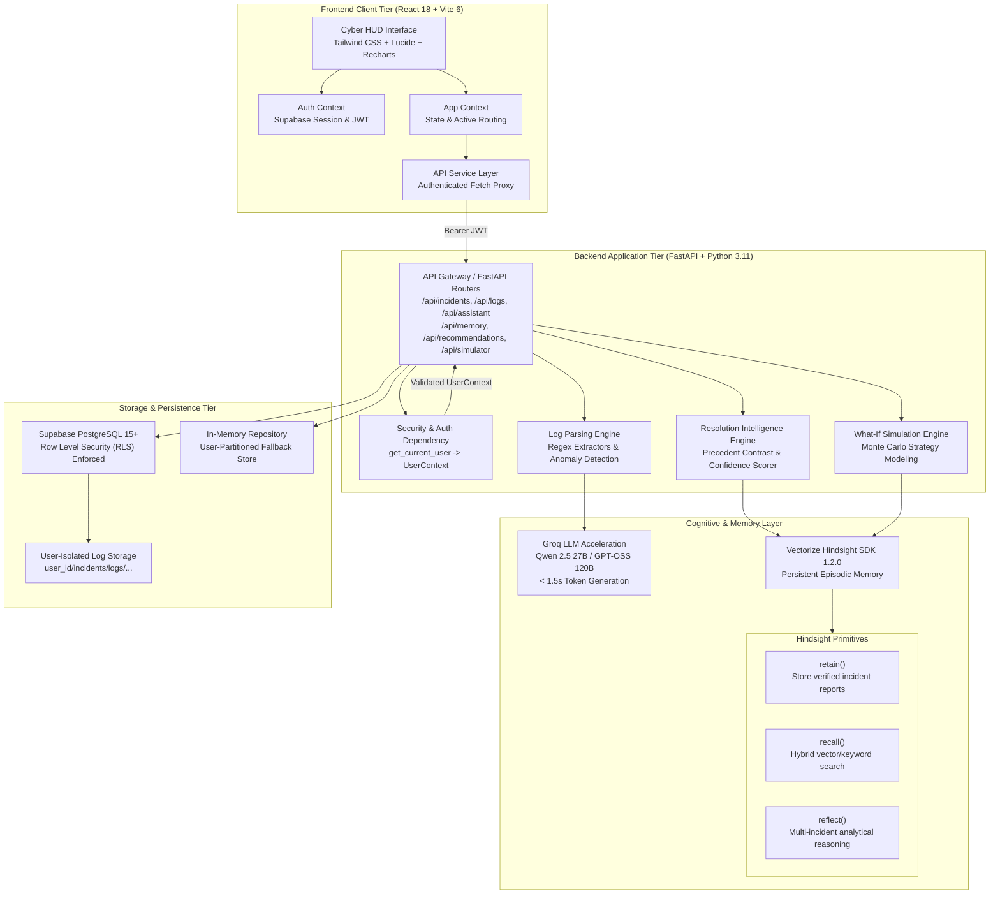
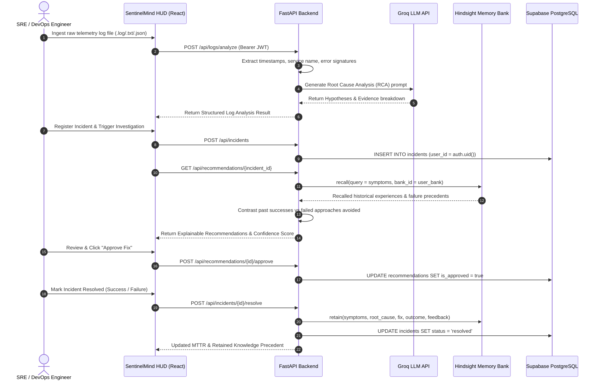

# SentinelMind System Architecture

This document provides a comprehensive technical blueprint of **SentinelMind**, describing its architectural tiers, component responsibilities, multi-tenant isolation guarantees, and cognitive memory lifecycle.

---

## 1. High-Level Architectural Blueprint

SentinelMind is architected as an asynchronous, multi-tenant AI operations platform that couples rapid log parsing and cloud LLM inference with persistent episodic agent memory.



---

## 2. Component Responsibilities

### 2.1 Frontend Client Tier
* **Technology:** React 18, Vite 6, Tailwind CSS, Lucide React, Recharts.
* **Responsibilities:**
  - Render dark cybernetic HUD styling (`#070D18` background, `#168DCE` borders, `#38BDF8` text accents).
  - Manage client authentication sessions and JWT token refresh via `@supabase/supabase-js`.
  - Handle drag-and-drop log ingestion (.log, .txt, .json) and visualization.
  - Present real-time telemetry dashboards, MTTR compression curves, and confidence breakdowns.
  - Provide human-in-the-loop incident triage and one-click recommendation approval.

### 2.2 Backend Application Tier
* **Technology:** FastAPI 0.115+, Pydantic v2, Python 3.11+, Uvicorn, HTTPX.
* **Responsibilities:**
  - Enforce authentication on all private endpoints via `get_current_user` dependency.
  - Normalize unstructured log streams into structured JSON events with severity categorizations.
  - Orchestrate LLM prompts for root cause analysis and dynamic strategy generation.
  - Mediate memory operations against user-specific Hindsight banks.
  - Calculate empirical workspace metrics (Mean Time to Resolve, success rates, resolution velocity).

### 2.3 Cognitive & Memory Tier
* **Technology:** Vectorize Hindsight Client 1.2.0, Groq API SDK.
* **Responsibilities:**
  - **Hindsight `retain()`**: Commit verified resolution outcomes (symptoms, root cause, applied fix, outcome: success/failure, engineer feedback) into persistent memory.
  - **Hindsight `recall()`**: Query the user's isolated memory bank before generating recommendations to retrieve relevant historical precedents with similarity scores.
  - **Hindsight `reflect()`**: Synthesize multi-incident patterns and cross-service correlations to formulate proactive architectural insights.
  - **Groq LLM Acceleration**: Provide sub-second inference using `qwen/qwen3.8-27b` and `openai/gpt-oss-120b` to differentiate between confirmed log evidence and agent hypotheses.

### 2.4 Data & Persistence Tier
* **Technology:** Supabase PostgreSQL 15+, Row Level Security (RLS), Local Repository Partition.
* **Responsibilities:**
  - Enforce table-level data ownership using `user_id UUID REFERENCES auth.users(id)`.
  - Guarantee row isolation using Postgres `auth.uid()` security policies.
  - Maintain an in-memory repository partitioned by `user_id` for local development, rapid unit testing, and sandbox operation.

---

## 3. End-to-End Incident Lifecycle



---

## 4. Multi-Tenant Data Isolation Architecture

SentinelMind guarantees strict data isolation between registered operators. Data created by User A never appears in or influences User B's workspace.

### 4.1 Identity Derivation
The frontend passes the authenticated user's Supabase JWT in the `Authorization: Bearer <token>` header. The backend parses and verifies the token server-side:
```python
async def get_current_user(request: Request) -> UserContext:
    token = extract_bearer_token(request)
    # Verified against Supabase Auth identity provider
    user = supabase_service.get_user(token)
    return UserContext(user_id=user.id, email=user.email, role=user.role)
```
User IDs supplied in request payloads are never trusted. All database queries and memory accesses use `current_user.id`.

### 4.2 Database Row Level Security (RLS)
Every table (`incidents`, `logs`, `recommendations`, `services`, `feedback`) includes a `user_id` foreign key referencing `auth.users(id)`:
```sql
ALTER TABLE incidents ENABLE ROW LEVEL SECURITY;

CREATE POLICY "Users can only access own incidents"
ON incidents FOR ALL
TO authenticated
USING (auth.uid() = user_id)
WITH CHECK (auth.uid() = user_id);
```

### 4.3 Cognitive Memory Partitioning
Memory banks are tenant-isolated. SentinelMind derives a deterministic, private bank identifier for each authenticated operator:
```python
def get_user_bank_id(self, user_id: str) -> str:
    clean = user_id.replace("-", "").replace("_", "")[:16]
    return f"sentinelmind-user-{clean}"
```
* **Private Recall:** User A's memory queries search only `sentinelmind-user-A`.
* **Private Retention:** User B's incident resolutions are indexed strictly into `sentinelmind-user-B`.
* **Zero Cross-Contamination:** A failed resolution in Tenant A will never influence Tenant B's confidence scores or recommendations.

---

## 5. Fault Tolerance & Fallback Strategy

| Scenario | Primary Path | Fallback Mechanism |
|---|---|---|
| **Groq API Rate Limit or Network Outage** | Cloud Groq API (`qwen/qwen3.8-27b`) | Automated model rollover to `openai/gpt-oss-120b`, followed by local rule-based heuristic diagnostic synthesis. |
| **Hindsight API Network Disconnection** | Cloud Hindsight API (`api.hindsight.vectorize.io`) | Local in-memory vector cache partitioned by bank ID with keyword/semantic scoring. |
| **Supabase Database Disconnected** | Supabase Managed PostgreSQL | Pre-seeded local repository mode preserving complete schema structures and CRUD operations. |
| **Missing Failure Precedents** | Recalled historical failures | Domain anti-pattern engine automatically populates real operational failure precedents avoided. |

